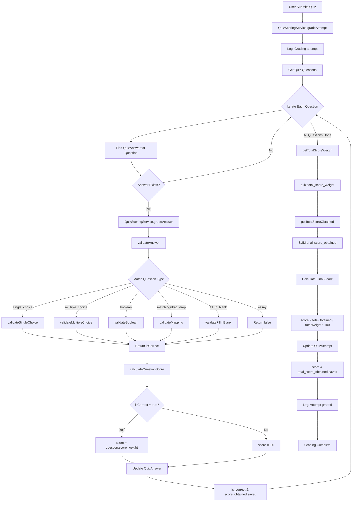
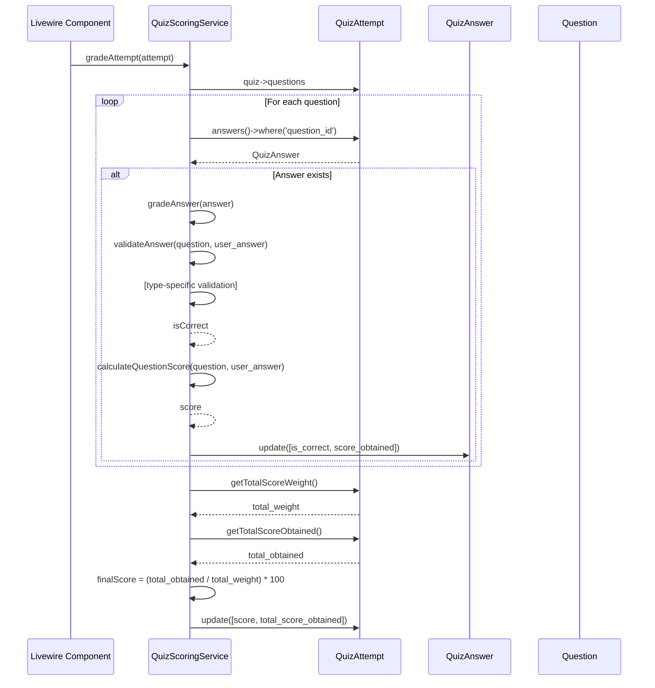

# Quiz Scoring Architecture

## Overview

This document outlines the architecture for the quiz scoring system that validates participant answers and calculates the total score based on weighted questions.

## Scoring Formula

```
Final Score = (Total Score Obtained / Total Score Weight) × 100%
```

Where:
- **Total Score Obtained** = Sum of all correct answers' scores
- **Total Score Weight** = Sum of all question weights in the quiz

## Database Schema

### Questions Table
- `id` - Primary key
- `quiz_id` - Foreign key to quizzes
- `type` - Question type (single_choice, multiple_choice, boolean, matching, drag_drop_sorting, drag_drop_zones, fill_in_blank, essay)
- `question_text` - The question content
- `question_config` (JSON) - Options, media, settings
- `answer_key` (JSON) - Correct answer(s)
- `explanation` - Explanation shown after answering
- `hint` - Optional hint
- `score_weight` - Weight for scoring

### QuizAnswers Table
- `id` - Primary key
- `quiz_attempt_id` - Foreign key to quiz_attempts
- `question_id` - Foreign key to questions
- `user_answer` (JSON) - User's submitted answer
- `is_correct` (boolean) - Whether the answer is correct
- `score_obtained` (decimal) - Score obtained for this question

### QuizAttempts Table
- `id` - Primary key
- `user_id` - Foreign key to users
- `quiz_id` - Foreign key to quizzes
- `score` (decimal) - Final calculated score (0-100)
- `total_score_obtained` (decimal) - Sum of all obtained scores
- `started_at` - When the attempt started
- `finished_at` - When the attempt finished
- `current_question_index` - Current question being viewed

### Quizzes Table
- `id` - Primary key
- `lesson_id` - Foreign key to lessons
- `pass_score` - Minimum score to pass
- `time_limit_minutes` - Time limit for the quiz
- `total_score_weight` - Sum of all question weights

## Architecture

### 1. QuizScoringService

**File:** `app/Services/QuizScoringService.php`

The service contains all scoring logic:

```php
class QuizScoringService
{
    // Public Methods

    /**
     * Validate a user's answer against the answer key
     */
    public function validateAnswer(Question $question, $userAnswer): bool

    /**
     * Calculate score obtained for a single question
     */
    public function calculateQuestionScore(Question $question, $userAnswer): float

    /**
     * Grade a single answer (update is_correct and score_obtained)
     */
    public function gradeAnswer(QuizAnswer $answer): void

    /**
     * Grade entire quiz attempt
     */
    public function gradeAttempt(QuizAttempt $attempt): void

    // Protected Validation Methods

    protected function validateSingleChoice($userAnswer, $answerKey): bool
    protected function validateMultipleChoice($userAnswer, $answerKey): bool
    protected function validateBoolean($userAnswer, $answerKey): bool
    protected function validateMapping($userAnswer, $answerKey): bool
    protected function validateFillInBlank($userAnswer, $answerKey): bool
}
```

### 2. Answer Validation Logic

Different question types require different validation strategies:

#### Single Choice (`single_choice`)
- Compare user's selected value with answer_key
- Exact match required (string comparison)
- Supports array answer_key (takes first element)

#### Multiple Choice (`multiple_choice`)
- Compare user's selected array with answer_key array
- Sort both arrays before comparison
- All correct options must be selected AND no incorrect options selected

#### Boolean (`boolean`)
- Compare user's boolean value with answer_key
- Simple boolean comparison

#### Matching / Drag Drop (`matching`, `drag_drop_sorting`, `drag_drop_zones`)
- Compare user's mapping with answer_key mapping
- Sort by key before comparison
- Exact match required (no partial credit)

#### Fill in Blank (`fill_in_blank`)
- Compare user's text with answer_key
- Case-insensitive comparison
- Trim whitespace
- Support for multiple correct answers (array)

#### Essay (`essay`)
- Always returns `false` (requires manual grading)
- Score always 0.0

### 3. Score Calculation Flow



### 4. Model Methods

#### QuizAnswer Model
```php
// Relations
public function quizAttempt(): BelongsTo
public function question(): BelongsTo

// Casts
- user_answer: array
- is_correct: boolean
- score_obtained: decimal:2
```

#### QuizAttempt Model
```php
// Relations
public function user(): BelongsTo
public function quiz(): BelongsTo
public function answers(): HasMany

// Helper Methods
public function getTotalScoreWeight(): int
    // Returns: quiz->total_score_weight

public function getTotalScoreObtained(): float
    // Returns: SUM of all answers->score_obtained

public function isPassed(): bool
    // Returns: score >= quiz->pass_score

// Casts
- score: decimal:2
- total_score_obtained: decimal:2
- started_at: datetime
- finished_at: datetime
```

#### Question Model
```php
// Relations
public function quiz(): BelongsTo
public function answers(): HasMany

// Casts
- question_config: array
- answer_key: array
- score_weight: integer
```

### 5. Integration with Livewire Component

Update `QuizAttempt.php` Livewire component:

```php
public function finalizeSubmission()
{
    // Grade the attempt using service
    $scoringService = app(QuizScoringService::class);
    $scoringService->gradeAttempt($this->attempt);

    // Update finished_at
    $this->attempt->update([
        'finished_at' => now(),
    ]);

    // ... rest of the logic
}
```

### 6. Method Call Sequence



## Implementation Status

✅ QuizScoringService created with all validation methods
✅ gradeAnswer() method for grading single answers
✅ gradeAttempt() method for grading entire attempt
✅ QuizAttempt helper methods (getTotalScoreWeight, getTotalScoreObtained, isPassed)
✅ Support for all question types
✅ Logging for debugging

## Edge Cases Handled

1. **Empty answers** - Returns false in validateAnswer
2. **Invalid answer format** - Type checking in validation methods
3. **Missing answer_key** - Returns false in validateAnswer
4. **Essay questions** - Always returns false, score = 0.0
5. **Multiple correct answers** - Supported in fill_in_blank (array answer_key)
6. **Case sensitivity** - Text-based answers are case-insensitive
7. **Whitespace** - Trimmed in fill_in_blank validation

## Performance Considerations

1. **total_score_weight cached** - Stored in quizzes table
2. **total_score_obtained cached** - Stored in quiz_attempts table
3. **Logging** - Added for debugging and monitoring
4. **Efficient queries** - Uses relationships properly

## Future Enhancements

1. **Partial credit** - Award partial points for partially correct answers
2. **Negative marking** - Deduct points for wrong answers
3. **Time-based scoring** - Bonus points for fast answers
4. **Difficulty-based weighting** - Automatic weight based on question difficulty
5. **Analytics** - Track which questions are most frequently missed
6. **Essay grading** - Manual grading interface for instructors
